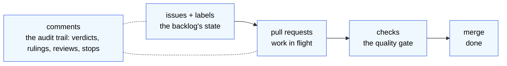
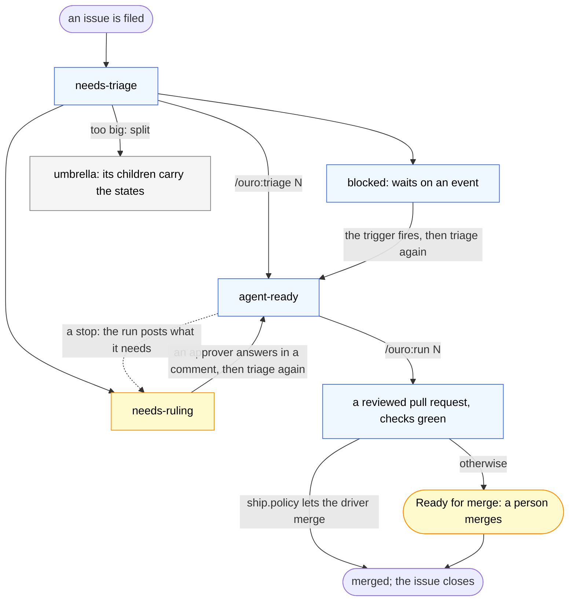

# ouro

The issue-driven agent loop for Claude Code and Codex. You write the issue; ouro takes it from
`agent-ready` to a merged pull request, and stops to ask the moment the spec and the code disagree.

Every open issue is either mechanically executable or waiting on exactly one named thing. This
repository is built by the loop it ships.

## GitHub is the state machine

There is no hidden database. Everything ouro knows, and everything it did, is on the tracker.

## An issue's life

Each open issue carries exactly one of eight state labels. Yellow marks where a person decides.

A person sets the other three: `human-ready` for work only a person can do, `idea` for no
commitment, and `architecture` for a design still being shaped, outside the working view until
the owner converts it. The modifiers `trivial` and `checkpoint` ride on `agent-ready`. Every state, and who
clears it, is in [the contract](docs/contract.md), section 4.

## Who does what

| You | The agent |
|---|---|
| File an issue: one deliverable, anchors into the code, a `Doc impact on close:` line. | Grades it against the code, and promotes it or asks one question with a recommendation. |
| Answer that question in a comment. | Builds in a worktree, runs the gates, opens the pull request, reviews it and fixes what the review finds. |
| Merge, when `ship.policy` leaves the merge to a person, and do whatever is `human-ready`. | Merges when the policy allows it and the checks are green, and files follow-ups for what it left. |

## Start in three steps

1. **Install and onboard.** `claude plugin marketplace add iteramen/ouro`, then
   `claude plugin install ouro@ouro`, then `/ouro:init` in the repository. Codex installs once per
   developer instead: see [the guide](docs/guide.md#codex-install-once-per-developer).
2. **File an issue and grade it:** `/ouro:triage N` (`$ouro-triage N` in Codex). Answer its
   question if it asks one, then triage again.
3. **Run it:** `/ouro:run N` (`$ouro-run N`). Run it again to resume after a merge, a ruling or a
   crash.

## Read on

- [The guide](docs/guide.md): whether ouro fits your repository, installing and updating, the
  commands and their exit codes, how the tracker is kept, and what a run posts.
- [The binding](docs/binding.md): `.claude/ouro.toml`, every key and its rules, the gates and the
  ship policies.
- [The contract](docs/contract.md): the protocol the driver and the gates enforce.
- [The architecture](docs/architecture.html): the layers, the run's steps and the nodes.
- [Changes](CHANGELOG.md): what each release moved. Consumers pin by tag.

## License

PolyForm Noncommercial 1.0.0 — free for individuals, nonprofits, education, and any noncommercial purpose; commercial use needs a license from the author. Full terms: `LICENSE`.

The public repository takes issues, not pull requests.
