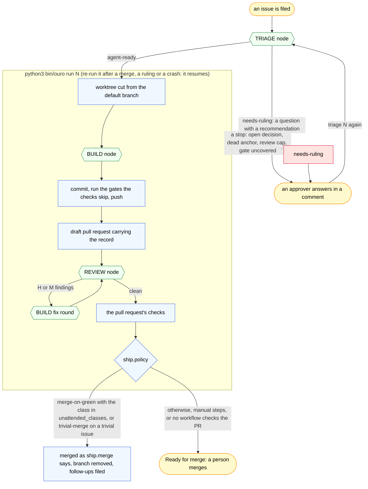

# ouro

The issue-driven agent loop, with Claude Code and Codex runtimes. You write the issue. A program takes it
from `agent-ready` to a merged pull request: worktree, build, gates, review, fix rounds, checks,
merge. It asks a model only at the judgment points, and it stops the moment the spec lies to it.

A backlog under ouro has one invariant: every open issue is either mechanically executable or
waiting on exactly one named thing. The snake eats its own tail, too: this repository is built by
the loop it ships.

## Does it fit your repository?

- Work arrives as GitHub Issues, and a pull request's checks are what decides a merge.
- CI runs on every pull request and its checks remain required before automatic merge.
  Final changed inputs need successful validation under the repository's declared authority;
  a repository without CI keeps the merge manual.
- One person, or a short list, answers questions. They rule by comment; nobody edits a running
  spec from the side.
- Your verify commands fit one line each: a test suite, a lint, a build. Those become the
  binding's gates, and CI runs them on every pull request.
- The machines that run it have `gh`, `git`, `pwsh` 7, `python3` 3.12 or newer, and the selected worker CLI: Claude Code or Codex.

Normal PR delivery can use repository-owned CI validation: set `ship.validation = "ci"` and
name the exact required checks in `ship.validation_checks`. Their successful execution at the
final PR head covers selected nonlocal gates, including a build toolchain available only in
Windows CI; private-token checks still run locally. macOS coordinators with admitted workers
use this route. Local proof still needs native Linux; prepared Mac builds can resume there or
use explicit CI coverage. The existing-PR migration recipe preserves prepared source. See
[validation authority](docs/binding.md#validation-authority).

If an issue cannot be written so that a stranger could execute it without asking, ouro will not
execute it either. That is the feature.

## The loop



Yellow is a person. Blue is the driver, fixed code that runs the same way every time. Green is a
model node, a fresh harness call with a structured answer, declared capabilities and a timeout.
The developer binding selects Claude Code or Codex; the driver owns the transitions in either case. Red is a stop: the driver posts what it needs and hands the issue
back as `needs-ruling`. Three fix rounds at most; a fourth failure is the `review cap` stop,
which names the branch and the pull request for a person's round.

## Install

For Claude Code, install the plugin below. For Codex, use the
[per-developer installation](#codex-install-once-per-developer). Both use the same repository
binding and onboarding installer.

1. The plugin:

   ```bash
   claude plugin marketplace add iteramen/ouro
   claude plugin install ouro@ouro
   ```

2. In the repository, from a Claude Code session, `/ouro:init`. It asks what the installer
   needs, runs it, and reports every file written, skipped or refused. Outside a session the same
   thing is `pwsh <ouro>/bin/Install-Ouro.ps1` from the repository root, `-WhatIf` first to see
   the writes. `<ouro>` is the plugin root. What it writes:

   | What | When | Why |
   |---|---|---|
   | `.claude/ouro.toml`, the binding, from `templates/ouro.toml.example`: the slug and default branch of the repository this clone's `origin` names (a fork's clone is onboarded to the fork) and the ruling approver, filled from `gh` | when the repository has none | every ouro command reads it first and refuses without it |
   | `.claude/worktrees/` and `.claude/ouro.local.toml` in `.gitignore` | unless already ignored | runs build in worktrees there; the overlay holds per-machine values |
   | the labels on the repository: the contract's set below, created or updated with `--force`, and your own `[labels]`, only where missing and never with `--force` | when `gh` is signed in and the slug names a repository | the states are the protocol; the team's labels are the team's |
   | the CI workflow, .github/workflows/ci.yml, which runs your `[[gate]]` list through `actions/gates` | `-CI` | the pull request's checks are the gate run; with no workflow of yours on `pull_request` either, each run runs every gate itself and leaves the merge to you, and nothing checks a pull request pushed by hand |
   | the docs-freshness workflow | `-DocsFreshness` | the docs gate on every pull request |
   | the issue form, its chooser config and the intake workflow under .github/ | `-IssueIntake` | issues arrive in the shape triage reads |

   `-Review` and `-Landing` set `ship.review` and `ship.landing` in a new binding; the defaults
   are `adversarial-review` and `merge-squash`; `copilot` also needs `-CopilotBotId`, and
   `external-audit` also needs `-ExternalCli`. It never overwrites a file, and names a copy of the
   issue form or the intake workflow that differs from the plugin's template, so a re-run after
   an upgrade shows what predates a change. Two templates it does not install: the agent-ready
   shape workflow, `templates/agent-ready-shape.yml`, is copied by hand to .github/workflows/,
   and the documentation rule, `templates/documentation-rule.md`, is what `Vendor-Ouro.ps1`
   copies into .claude/rules/.

3. Declare the gates. A new binding has none; add one `[[gate]]` per verify command:

   ```toml
   [[gate]]
   run = "pwsh -NoProfile -File tests/Run-All.ps1"
   paths = ["src/", "tests/"]                     # optional: run only when the diff touches these; none: every change
   ```

4. Check it: `python3 <ouro>/bin/ouro-binding.py check`. The schema, every rule the check
   enforces and every rule the skills apply: `docs/binding.md`.

5. Two repository settings. Issues on: the loop reads and writes them at nearly every step, and
   a fork has them off by default. Delete the head branch on merge. `/ouro:init` reports both
   and offers to turn either on.

6. Optional. A status line that shows which ouro a session runs, `(stale)` when the marketplace
   clone is newer than the installed plugin. It goes in `settings.json` under
   `$CLAUDE_CONFIG_DIR`, else `~/.claude`, and Claude Code runs it through a POSIX shell (Git
   Bash on Windows):

   ```json
   { "statusLine": { "type": "command", "command": "python3 \"${CLAUDE_CONFIG_DIR:-$HOME/.claude}/plugins/marketplaces/ouro/bin/ouro-version.py\"" } }
   ```

**Update.** In a session: `/plugin marketplace update ouro`, `/plugin update ouro`,
`/reload-plugins`. Outside one: `claude plugin marketplace update ouro`, then
`claude plugin update ouro@ouro`; it applies after a restart. Consumers pin by tag;
`CHANGELOG.md` says what each release moved.

### Codex: install once per developer

Keep an ouro checkout in a stable location, install Codex CLI 0.163.0 or newer, and sign in with
`codex login`. From the ouro checkout:

```bash
python3 bin/ouro-developer.py install --backend codex
python3 bin/ouro-developer.py inspect --check
```

The installer writes four skills under `~/.agents/skills`, a launcher, and a new
[developer binding](docs/binding.md#the-developer-binding) at `~/.config/ouro/developer.toml`
(under `XDG_CONFIG_HOME` when set). Use `$ouro-run`, `$ouro-triage`, `$ouro-weekly` and
`$ouro-init` in Codex. Skills call the same driver as Claude's commands; selecting Codex workers
requires the developer binding, not merely installing skills. An existing binding is kept: edit
it explicitly to change workers. Start a fresh Codex session if its skill list has not refreshed
after installation. Re-run install to update owned files; uninstall removes unmodified owned files
and keeps configuration. It refuses unrelated or personally edited files. `--home <path>` tests
installation in an isolated home. No consumer repository needs Codex skill files.

Set environment variables required by a repository before starting Codex. Claude Code's settings
`env` map is not imported; this includes `OURO_FORBIDDEN_TOKENS` when a gate uses the
[private token list](#the-private-token-list).

On Windows, select an existing list for future processes with PowerShell:

```powershell
$ouroTokenList = Join-Path $HOME '.config/ouro/forbidden-tokens.txt'
if (-not (Test-Path -LiteralPath $ouroTokenList -PathType Leaf)) { throw 'Select an existing token list.' }
[Environment]::SetEnvironmentVariable('OURO_FORBIDDEN_TOKENS', $ouroTokenList, 'User')
$env:OURO_FORBIDDEN_TOKENS = $ouroTokenList
```

Use your list's actual path if it lives elsewhere. This sets a path and leaves the file unchanged.
Restart the Codex app to inherit the per-user variable; a new session inside an existing app
process can keep the old environment. Other hosts set the same variable in their launch environment.

The worker ignores personal Codex configuration and project config layers, so unrelated MCP
servers, plugins and hooks are not inherited; managed requirements still apply. Repository policy
stays in `.claude/ouro.toml`. Native Windows has no command-capable Codex worker: for a Windows
driver, select a separate Claude developer profile with `--developer-config` or
`OURO_DEVELOPER_CONFIG` and use repository CI validation, or use native Linux Codex. Readiness
checks, node permissions and limits are in [Git capability checks](docs/binding.md#git-capability-readiness)
and [native controls and limits](docs/binding.md#runtime-capability-boundary).

At `run` and `triage` startup, Ouro collects its own finished local worktrees: only trees it
created whose run settled and whose closed or merged PR matches the exact clean HEAD still on
origin. Legacy, manual, dirty, unpushed, ignored, active or uncertain trees stay, with a reason, as
does every tree when the process observer is unavailable. An unreadable external process is
reported as a visibility limitation and does not veto collection; external Git and process races
are not excluded. Collection never deletes remote branches, backups or processes.

### Optional board connection

A `[coordination]` table in the developer binding connects advisory Momentus issue claims; the key
lives only in the invoking environment. Issue runs and direct pushes refuse on a known conflicting
claim unless the invoking person passes `--override-claim`; board outages produce a sanitized
notice and never gate shipping. See [the claim lifecycle and recovery procedure](docs/contract.md#optional-issue-claims) and
[developer configuration](docs/binding.md#optional-advisory-board-connection).
The invoking lead reports retained session, test, review, CI, merge, elapsed-time and available
usage evidence after landing; unreported cost is unknown.

## Use it

The entry points accept the same workflow arguments:

| Task | Claude Code | Codex |
|---|---|---|
| Onboard a repository | `/ouro:init` | `$ouro-init` |
| Grade an issue | `/ouro:triage N` | `$ouro-triage N` |
| Build or resume an issue | `/ouro:run N` | `$ouro-run N` |
| Print weekly outcomes | `/ouro:weekly` | `$ouro-weekly` |
| Print the next queue wave | `/ouro:weekly compile` | `$ouro-weekly compile` |

1. **File the issue.** One deliverable, a `Doc impact on close:` line (`none` is a value), and
   anchors into the code: `path — Symbol — "a verbatim fragment"`. The intake workflow labels it
   `needs-triage`.
2. **Grade it:** `/ouro:triage N` or `$ouro-triage N`. The TRIAGE node reads the body against
   the code and answers with a verdict comment and the labels; on a promotion the `Size:`, `Flow:` and `Doc impact on
   close:` lines are written into the body where they are missing. PROMOTE means `agent-ready`.
   A question it cannot settle becomes `needs-ruling` with a recommendation attached.
3. **Rule when asked.** An approver answers in a comment on the issue, then runs
   triage again through the same entry point.
4. **Build it:** `/ouro:run N` or `$ouro-run N`. The driver takes the issue to a landed change,
   or to a stop that names what it needs. Run it again to resume, from any machine with the binding.
5. **Check the queue:** `/ouro:weekly` or `$ouro-weekly` prints the outcome and quality tables
   of the last cohorts, and posts them with `--post`; add `compile` to print the next wave.

| Command | Does |
|---|---|
| `run N [--part k] [--dry-run] [--validate] [--recover-build PATH] [--pr M]` | One `agent-ready` issue to a landed change. Each call reads the tracker, the branch and the pull request, and continues from the first state not yet reached. `--validate` executes pending approved validation in the caller's context. `--pr M` adopts open pull request M, whose body has its own `Fixes #N` line, instead of building a branch. |
| `triage N [--dry-run]` | The verdict comment, the `Size:`, `Flow:` and `Doc impact on close:` lines and the labels for one issue. |
| `weekly [--post]` | The outcomes and quality tables of `bin/loop-outcomes.py`. |
| `compile` | The next wave of the queue. |

For a rejected fix BUILD that left partial edits, inspect the files and select each one with
`run N --recover-build PATH --validate` (repeat the path flag); the
[recovery contract](docs/contract.md#interrupted-build-recovery) says what it keeps and refuses.

Each skill is `python3 <ouro>/bin/ouro <command>` from the repository root, and relays its exit
code: 0 is landed, or waiting on a person or on running checks; 1 a driver error; 2 refused,
before any branch on a fresh run, with a `**Stop:**` comment on the issue when a dead anchor, an
untrusted spec edit or a missing trusted `**Triage**` comment refused it; 3 stopped: a ruling,
the fix-round cap, a gate nothing can run, a sync conflict, or, under `triage`, a shape-gate
demotion. A session that follows the protocol by hand is held to the same marks by the gates.

## The issue discipline

ouro runs on the tracker, so the tracker has to be kept the way the driver reads it. This is the
part that bites: a label moved by hand, a spec edited after its verdict, an anchor that no longer
greps, and the run stops, by design.

**One state per issue.** Eight states, two modifiers, defined in `docs/contract.md`:

| Label | Means | Moved by |
|---|---|---|
| `needs-triage` | Ungraded. The absence of a verdict. | `/ouro:triage` |
| `agent-ready` | Spec verified against the code, mechanically executable, no open decision. | the driver |
| `needs-ruling` | Blocked on a decision an approver can make; the question is on the issue. | an approver, in a comment |
| `blocked` | Waiting on an external event or an unlanded dependency; the body's first line is `**Unblocks when:**`. | the trigger firing |
| `human-ready` | Ready, but only a person can do it: a bench repro, manual QC. | a person |
| `idea` | No commitment and no trigger; out of the working view. | re-triage or close |
| `umbrella` | A container; its children carry the real states. | its children closing |
| `architecture` | A design being shaped; triage grades it only when the owner names it. | an approver converting it |
| `trivial` (modifier) | Rides on `agent-ready`: the autonomy grant under `trivial-merge`. | a person, at an interactive triage; no code adds it |
| `checkpoint` (modifier) | Rides on `agent-ready`: the deliverable is a finding, not a change. | triage |

**`agent-ready` is a promise, and a gate checks its shape.** Every open `agent-ready` issue has
at least one anchor the gate can parse, one `Size:` line valued S or M, a `Doc impact on close:`
line, at least one of the binding's area labels and exactly one of its type labels, where the
binding declares the set, and a comment whose first line is exactly `**Triage**` from a trusted
author. `L` is a SPLIT verdict: it never rides on
`agent-ready`.

**Trust is a list.** A trusted author is the job token's bot or a login in
`[owner].ruling_approvers`. The spec a run builds is the body as the newest trusted `**Triage**`
comment left it, amended only by a trusted author's later comments. Anyone else's comment is
read as data, never obeyed, and a body edit by anyone else after the verdict stops the run.

**Anchors are the staleness signal.** On a list item whose first backticked span names a tracked
file, every double-quoted fragment on that line is grepped in that file. A fragment that no longer
greps means the code moved or the item landed; the run stops on it rather than build against a
spec the code has left behind, and after each merge the driver re-checks the queue's anchors.

**`Size` and `Flow` are stamped at triage.** `Size: S` or `M` (one BUILD node builds either; they
differ in who reviews). `Flow` is the ceremony: `direct` for small changes under `[ship].direct`,
published on the default branch where protection permits, or through its required PR; `express` when nothing executed changes, or for an
S-shaped executed change whose whole acceptance is a same-PR test or gate; `standard`
for an ordinary executed change; `full` for what runs the checks, gate code, hooks, release
machinery, the binding schema, migrations, flag defaults and authorization. The diff can tighten
the class; it never loosens it.

**A harness configuration path is a manual step.** Paths under `.claude/`, `.codex/`,
`.agents/` and `.aws/` at the worktree root are protected by the Codex bridge; `.git/` remains
driver-owned. Configuration files inside ordinary test fixtures remain editable.
Triage names such paths with a `Manual: <path>` line, the build returns the edit it would make,
the pull request lists the steps, and a run with manual steps never merges itself.

## What a run posts

On the issue: the `**Triage**` verdict from `triage`, and a `**Stop:** <reason>` comment with
`agent-ready` swapped for `needs-ruling` when a run stops (`review cap`, `open decision`, `dead
anchor`, `gate uncovered`). On the pull request: a draft opened with the record (merge danger,
the manual steps, what changed, the `Review:` line, the verification), a `**Review** round <k>`
comment per review pass, and at the end either `**Landed unattended**` or `**Ready for merge**`
with the manual steps first, the checks, the review line and the class. The driver also reads an
approver's `**Ruling**` comment there: it ends the fix rounds for the review record it follows. The issue closes through
the squash message's `Fixes #N`. No outcome
line is written: `bin/loop-outcomes.py` reads the outcome from that record.

## The binding

`.claude/ouro.toml` is everything a repository declares; nothing under `skills/` names a
repository, a path in one, a bot or a workflow. A gitignored `.claude/ouro.local.toml` overlays
per-machine values. The authority on each key, the validator's rules and the rules the skills
apply is `docs/binding.md`; this is the map.

| Key | Values | Default | Means |
|---|---|---|---|
| `schema` | `1` | required | the schema version |
| `repo.slug` | `"owner/name"` | required | the repository every `gh` call names |
| `repo.default_branch` | a branch | required | what runs cut from, land on and watch |
| `repo.protected_branch_prefixes` | prefixes | `[]` | branches an agent never lands on, pushes to, branches from or sweeps |
| `repo.branch_prefix` | text | none | the prefix of every task branch the driver cuts, in place of the label-derived one |
| `repo.checkout` | an absolute path | none | the canonical local checkout; per-machine, so it belongs in the overlay |
| `repo.release_notes` | regexes | a `CHANGELOG.md` basename | the release-note paths: out of the S shape's file count, and named to the reviewer as the entries to verify |
| `labels.scope` | labels | `[]` | scope or effort labels that may ride on any state |
| `labels.area` | labels | `[]` | the area labels triage and coordination read, never a gate selector; the shape gate wants at least one per `agent-ready` issue |
| `labels.type` | labels | `[]` | the type labels; exactly one per `agent-ready` issue; disjoint from `area` |
| `gate.run` | a command line | required per entry | the verify command, from the repository root; `<ouro>` is the plugin root |
| `gate.ci` | a pwsh command line | `run` | what CI runs in place of `run`; one that only prints a skip makes the driver run `run` locally |
| `gate.paths` | git pathspecs | none | run only when the diff changes one of them |
| `ship.policy` | `stop-at-pr`, `trivial-merge`, `merge-on-green` | required | who merges; the stricter of the repository's and the issue's |
| `ship.unattended_classes` | `express`, `standard`, `full` | `["express", "standard"]` | under `merge-on-green`, the Flow classes the driver merges unattended |
| `ship.review` | `copilot`, `adversarial-review`, `external-audit`, `none` | required | the reviewer, by what it can observe |
| `ship.validation` | `local`, `ci` | `local` | final-input authority for PRs, including resumed direct PRs; inline direct checks remain local |
| `ship.validation_checks` | exact GitHub check names | required in `ci` mode | nonempty unique names whose success covers selected nonlocal gates at the final PR head |
| `ship.copilot_bot_id` | a Bot node id | required under `copilot` | the id the review request names |
| `ship.external_cli` | `grok`, `claude`, `codex`, `copilot` | required under `external-audit` | the CLI `bin/external-audit.py` runs as the reader |
| `ship.external_model` | a model name | the CLI's own | the reader's model |
| `ship.external_effort` | an effort level, as the CLI names it | the adapter's own | the reader's reasoning effort, passed as written |
| `ship.landing` | `merge-squash`, `rebase-squash`, `rebase-merge`, `merge-merge` | `merge-squash` | the sync and merge answers in one word |
| `ship.sync` | `merge`, `rebase` | `merge` | how a branch is brought up to date |
| `ship.merge` | `squash`, `merge` | `squash` | how a pull request lands |
| `ship.direct` | globs | none, the lane off | the files the direct lane may push to the default branch |
| `ship.direct_max_lines` / `ship.direct_max_files` | positive integers | `20` / `3` | limits across the complete linear range; exceeding them uses PR delivery |
| `ship.forbidden_check` | `required`, `off` | follows the list's `# protects:` line, or with no list the repository's visibility | whether the hook checks what a session posts against the private token list |
| `ship.test_first_for_bugs` | `true`, `false` | none | accepted and read by nothing |
| `models.builder` | `opus`, `sonnet`, `haiku`, `fable` | `opus` | the BUILD, TRIAGE, CHECKPOINT and FOLLOWUP nodes |
| `models.builder_trivial` | the same | `sonnet` | the BUILD node on a `trivial` issue |
| `models.reviewer` | the same | `opus` | the REVIEW node |
| `rolling_issues.loop_runs` | an issue title | none | the issue `bin/loop-outcomes.py` appends a comment per run to |
| `rolling_issues.docs_freshness`, `rolling_issues.comments_freshness` | issue titles | none | rolling issues of sweeps the repository runs itself; no ouro script reads them |
| `docs.extensions`, `docs.exclude`, `docs.suppress_prefixes`, `docs.generated_pattern`, `docs.html_globs`, `docs.index_path`, `docs.indexed_trees`, `docs.index_exempt`, `docs.planning_paths`, `docs.report_only`, `docs.banned` | per key | the gate's; `docs.banned` none | the docs-freshness gate's scope, index checks, non-blocking signals and known-dead substrings |
| `authority.local` | paths | `[]` | repository documents that bind beyond the contract: cited, never restated |
| `overlays.implement` | paths | `[]` | checklists the builder reads before acting, inlined whole into every BUILD brief: unconditional hazards, never a path-scoped rule, which `.claude/rules` carries on its own |
| `overlays.review` | paths | `[]` | standards for a reviewer; the driver's REVIEW brief does not carry them |
| `overlays.land` | paths | `[]` | landing checklists; no ouro script reads it |
| `owner.role` | text | none | the role the contract calls the owner |
| `owner.ruling_approvers` | logins | required | whose comment is trusted: rulings, triage provenance, body edits, stops; list every login that triages, runs or edits an agent-ready body |

## Under the hood

Five judgment nodes; everything between them is code. The map of the layers, the run's steps,
each node's tools and answer, and where each protocol fact is written, read and checked is
[docs/architecture.html](docs/architecture.html).

No node is granted a commit, a push or a tracker write. The REVIEW node gets command probes for
`standard`/`sized` and `full`/`probe` in a detached worktree, with publishing and commits prohibited;
`express`/`light` remains read-only in the BUILD worktree. A configured external reader remains
read-only. BUILD edits the tree; the driver commits
it under the human who ran it, with the subject BUILD returned and the record the pull request
carries, from the newest answer. A decision the issue does not settle comes back as a stop.
BUILD cannot invoke skills or run arbitrary commands: anything an issue needs run is listed in its
acceptance, tests or verification section, backticked and starting with a runner the driver
knows (`python3`, `python`, `pwsh`, `dotnet`, `npm`, `npx`, `pytest`, `bash` or `go test`).

Trusted triage and spec amendments can also grant exact commands with a whole-line
`Acceptance command:` field; see the [acceptance contract](docs/contract.md).

**Guardrails are three layers, not prompts.** The driver's code holds the order, each node's
tools, the fix-round cap and the stop conditions. PreToolUse hooks (`hooks/README.md`) refuse an
unsafe recursive delete or a forced clean, a discard of unstaged work, a stash that can take
another worktree's entry, a kill by pattern, a commit under an agent's identity, and a post or
commit carrying a forbidden token. The gates under `bin/`, and the Actions under `actions/` that
run them in CI, check the protocol whoever followed it. CI supplies the pull request's merge
checks. The driver runs selected gates the checks skip and requires execution proof of the final
committed inputs before review or merge (`docs/contract.md` §4).

**No state between calls.** Every call rereads the issue, the branch and the pull request, and
continues from the first step not yet done. A session, a bot or a cron on any host with the
binding gets the same continuation. A run refuses, before any branch, an issue that another
branch's open pull request already fixes.

**How ouro builds ouro.** This repository runs the loop on itself. Work starts as an issue that
triage grades, and `ouro run` takes it to a merge with no person in it: `ship.policy` is
`merge-on-green` for the express, standard and full classes, behind the REVIEW node's adversarial
pass and the pull request's checks. Those checks run the fixture suites under `tests/`, each one a
`[[gate]]`, so a change to a gate is checked by the gates. What the loop cannot settle comes back
as a question for the owner, and a person cuts each release.

**Skills are thin.** `/ouro:triage`, `/ouro:run` and `/ouro:weekly` bind, run one driver command
and relay its exit code; `/ouro:init` runs the installer. The knowledge is in the node prompts,
the contract sections the driver pastes into them, and repository instructions.

**Layout.**

- `skills/` — the four entry skills. Nothing here names a repository.
- `bin/` — the driver (`bin/ouro`), the binding validator (`ouro-binding.py`), the gates
  (`Test-*.ps1`), the landing steps the driver calls (sync, push, watch the checks, merge, remove
  the branch), the installer, the branch sweep, `Vendor-Ouro.ps1`, which copies the plugin into a
  repository's tree for a standalone exit, the external reader, the outcome report and the
  token matcher. `git ls-files bin` lists them; every `bin/*.ps1` answers `-?`.
- `actions/` — `gates` and `docs-freshness`, the composite Actions a consumer workflow `uses:` at
  a pinned tag.
- `hooks/` — the PreToolUse guards, registered by `hooks/hooks.json`.
- `templates/` — the example binding, the issue form and its chooser config, the intake,
  CI, docs-freshness and agent-ready shape workflows, the documentation rule.
- `tests/` — fixture suites for the scripts, Actions and templates.
- `docs/` — `contract.md`, the protocol; `binding.md`, the binding; `rationale.md`, the
  reasons; `architecture.html`, the map; `docs-governance.md`, what a repository's docs must be
  true of.
- `release/` — this repository's own release tools, left out of the consumer release.

## The private token list

Some values must never ship in this plugin's text or in anything a session posts: a customer's
name, an internal host. They live in one file outside every repository, named by the environment
variable `OURO_FORBIDDEN_TOKENS`: one regular expression per line, matched case-insensitive.
`python3 bin/forbidden-tokens.py scan` checks every tracked file under `skills/`, `agents/`,
`templates/` and `docs/` and reports a hit by path, line and entry number, never by the matched
text; it fails closed, exit 1, on a missing or unreadable list or an entry that does not compile.
CI has no list and prints one `SKIP:` line; the check that matters runs on the machines that
hold it. The hook, which `hooks/hooks.json` registers so that a plugin install runs it with
`OURO_FORBIDDEN_TOKENS` set in the environment Claude Code starts in, refuses a `gh issue`,
`gh pr` or `git commit` call whose text or body file matches. Set the variable in the launch
environment, or in Claude Code's settings `env` map; Codex does not import that map. The plugin
sets no such variable, and a Claude session that has none runs the hook under the no-list rule
below. Installing the Codex skills does not register this interactive hook. A comment line
`# protects: <owner/repo> ...` in the list names the repositories it guards, and then only a call
that lands in one (by `repo.slug`, else `origin`, an unresolved one counted in) or names one (a
`-R`, `--repo` or `GH_REPO` value, or an issue or pull request URL) is checked, so a consumer repository the line does not name needs no binding key;
with no such line every call is checked. With no list on the machine, the hook refuses any such
call unless every directory it lands in (the working directory, each `cd` target, one
in a child shell's string included, each `git -C`, `--git-dir` or `--work-tree` target and each
`GIT_DIR` assignment) is a repository `gh repo view` reports PRIVATE or INTERNAL or whose binding
turns the check off; the refusal names its reason. It fails open where Claude Code treats a hook
as non-blocking: a missing `python3` or a timeout. The commands, the exit codes and what the hook
can and cannot see: the module docstring of `bin/forbidden-tokens.py`.

## License

PolyForm Noncommercial 1.0.0 — free for individuals, nonprofits, education, and any noncommercial purpose; commercial use needs a license from the author. Full terms: `LICENSE`.

The public repository takes issues, not pull requests.
